

  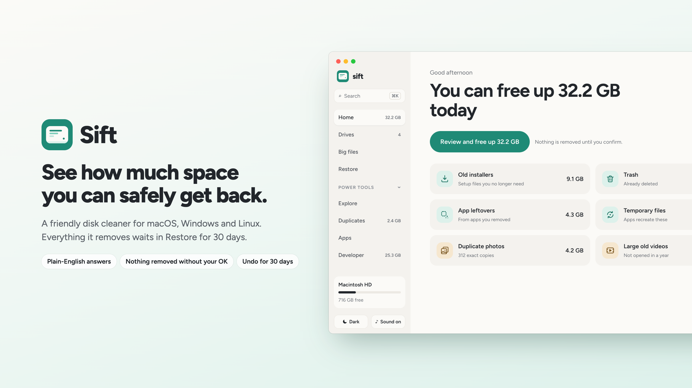

# Sift

A friendly disk-space cleaner for macOS, Windows and Linux. Sift answers one question, *how much can I safely free up?*, explains everything it finds in plain words, and lets you act in one click. Nothing is deleted on the spot: what Sift removes waits in **Restore** for 30 days, so you can always change your mind.

**[Download the latest release](https://github.com/idevtim/sift/releases/latest)** · [All releases](https://github.com/idevtim/sift/releases)

## Screenshots

  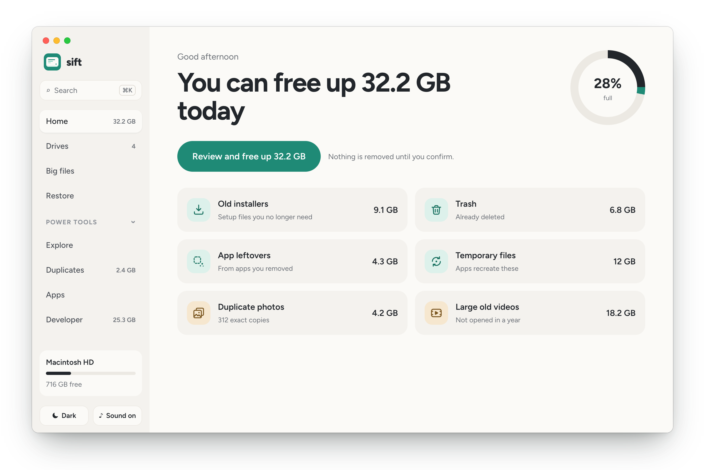
  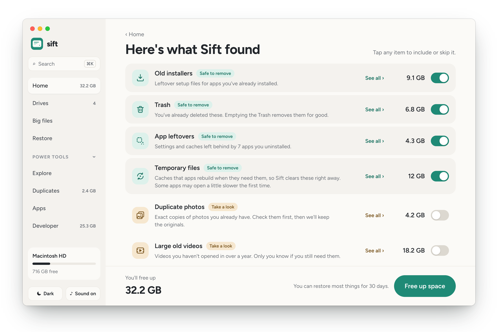

  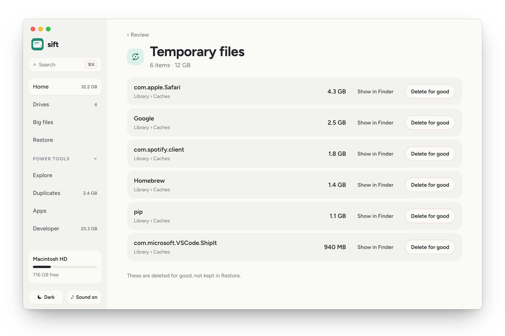
  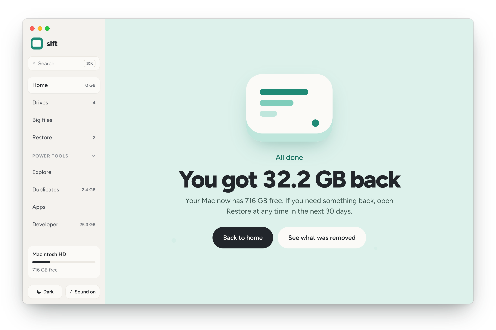

  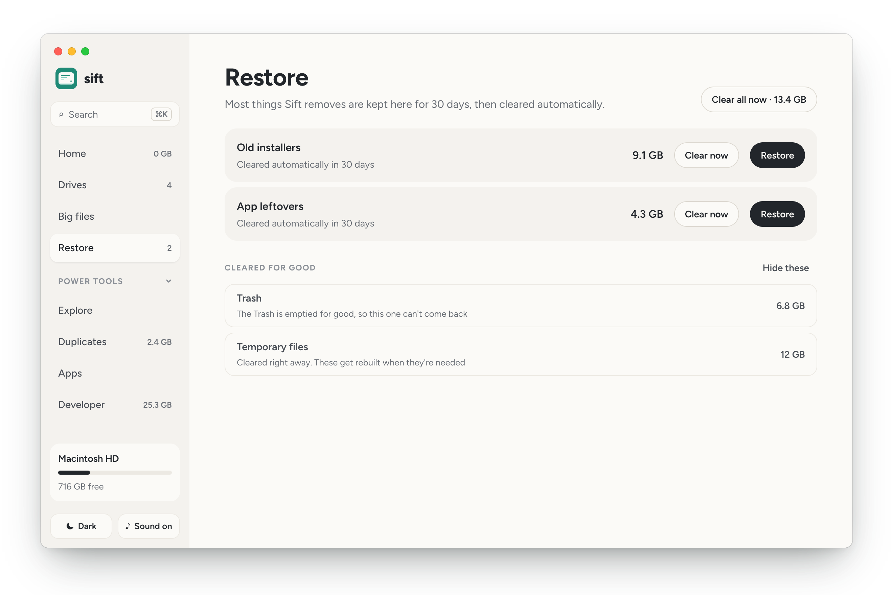
  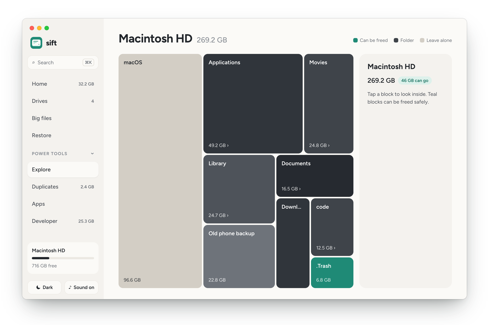

  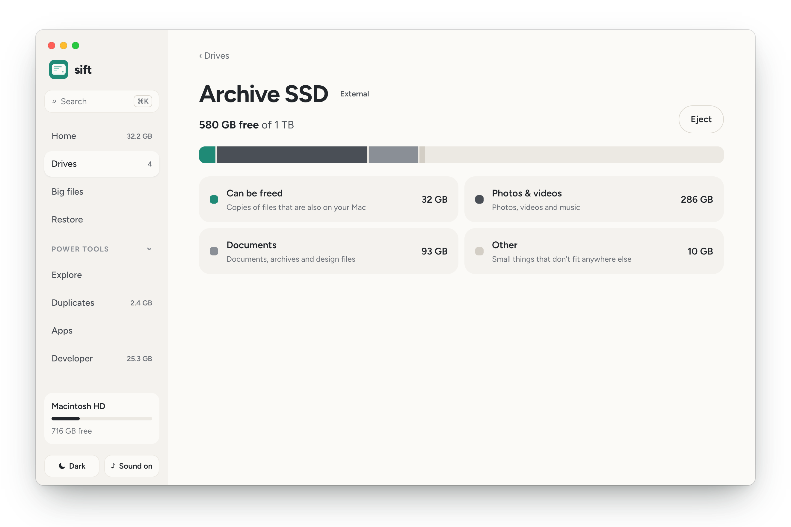
  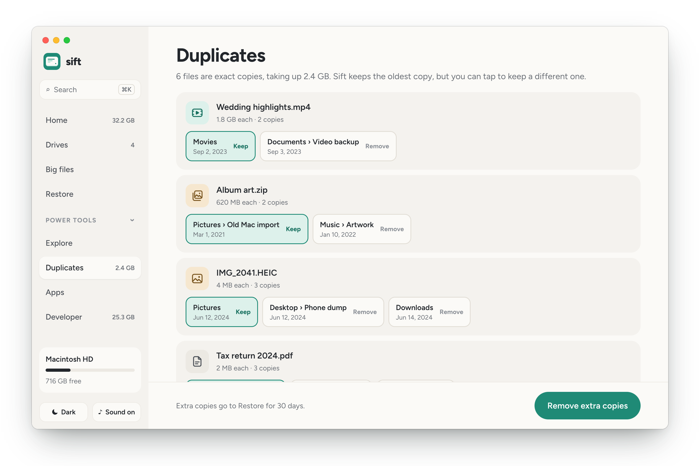

  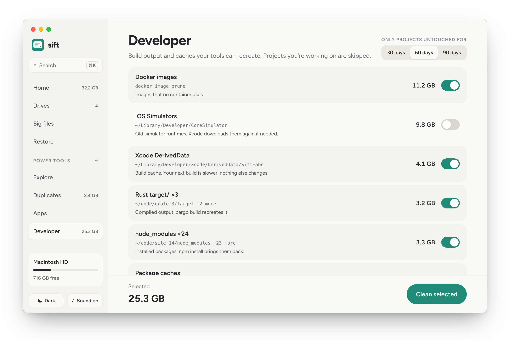
  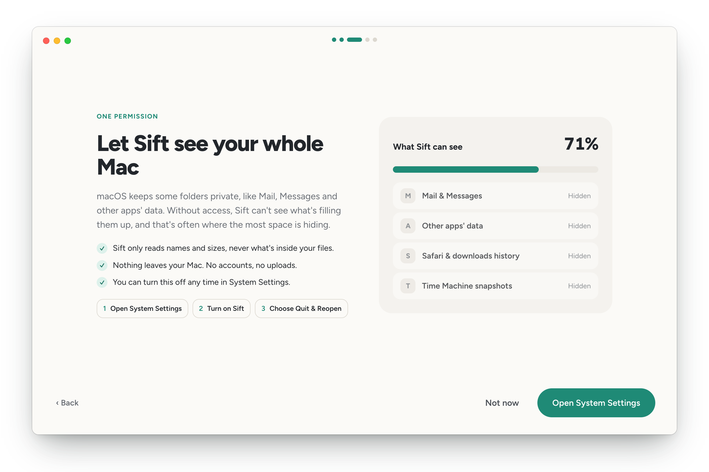

  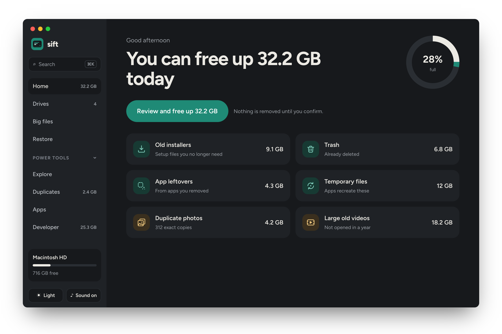

## Features

- **One clear number**: Home tells you how much you can free up today, in plain words
- **Six everyday categories**: old installers, the Trash (Recycle Bin on Windows), leftovers from apps you've uninstalled, temporary files, duplicate photos and large videos you haven't opened in a year
- **Review before anything happens**: safe categories are pre-selected, anything worth a second look starts off, and **See all** lists every file so you can show it in Finder/Explorer or remove items one at a time
- **Restore for 30 days**: removed things are held on the same drive and can be put back with one click. "Clear now" frees the space early, after a second click to confirm
- **Drives**: every connected disk at a glance; external drives and SD cards show what's on them, including copies of files already on your computer. Backup drives are never touched
- **Big files**: the largest things you haven't opened in a while
- **Power tools** for a closer look:
  - **Explore**: a treemap of your disk you can click into
  - **Duplicates**: exact copies (byte-for-byte), keeping the oldest by default
  - **Apps**: uninstall an app together with the settings and caches it leaves around
  - **Developer**: Docker images, iOS simulators, Xcode DerivedData, Rust `target/` and `node_modules` from projects you haven't touched lately
- **Weekly check-up**: Sift looks every Sunday and sends one notification if there's space worth freeing. It never removes anything on its own
- **Quick search** with ⌘K / Ctrl+K across files, pages and actions
- **Light and dark appearance**, soft optional sounds, and a short guided setup
- **Auto-update**: new versions download in the background; restart from the sidebar to install

## Install

Download the right file for your computer from the [latest release](https://github.com/idevtim/sift/releases/latest):

| Platform | File | Notes |
|----------|------|-------|
| **macOS** 10.15 or later | `Sift_<version>_universal.dmg` | Apple Silicon and Intel. Signed and notarized by Apple |
| **Windows** 10 or later | `Sift_<version>_x64-setup.exe` or `_arm64-setup.exe` | Installs for your user only, no admin needed |
| **Linux** (x64) | `.AppImage`, `.deb` or `.rpm` | Ubuntu 22.04+, Fedora, or similar |

### macOS: Full Disk Access

macOS keeps some folders private (Mail, Messages, other apps' data). On first launch Sift explains why it needs **Full Disk Access** and opens the right page in System Settings. Turn Sift on, choose **Quit & Reopen**, and you're done. You can skip it; Sift then works with what it's allowed to see, and Home offers it again later.

### Updates

Sift checks GitHub Releases in the background on launch. When a new version is ready, **Restart to update** appears at the bottom of the sidebar.

## How it works

- **Scanning is read-only.** Sift reads names and sizes, never what's inside your files (the one exception: comparing photos byte-for-byte to find exact duplicates, which happens entirely on your computer).
- **Removing means moving.** Items go into a holding area on the same drive, so it's instant and nothing is lost. They stay in Restore for 30 days, then are cleared.
- **A few things are deleted right away**, and Sift says so first: emptying the Trash, and caches or build output that apps and tools rebuild on their own (keeping those would only keep the space taken).
- **Cloud files stay in the cloud.** Files in iCloud Drive (or Desktop & Documents) that aren't downloaded are never opened, so a scan never triggers downloads.
- **Easy on your computer.** Scans use about a quarter of your processor cores, at low priority.

See [PRIVACY.md](PRIVACY.md) for exactly what Sift reads and what leaves your computer (nothing, apart from the update check).

## Feedback

- **Something not working?** [Report a bug](https://github.com/idevtim/sift/issues/new?template=bug_report.md)
- **Download or install trouble?** [Report a download issue](https://github.com/idevtim/sift/issues/new?template=download_issue.md)
- **Idea for Sift?** [Suggest a feature](https://github.com/idevtim/sift/issues/new?template=feature_request.md)
- **Security issue?** Please don't open a public issue; see [SECURITY.md](SECURITY.md)

---

© 2026 Timothy Murphy
