<p align="center">
  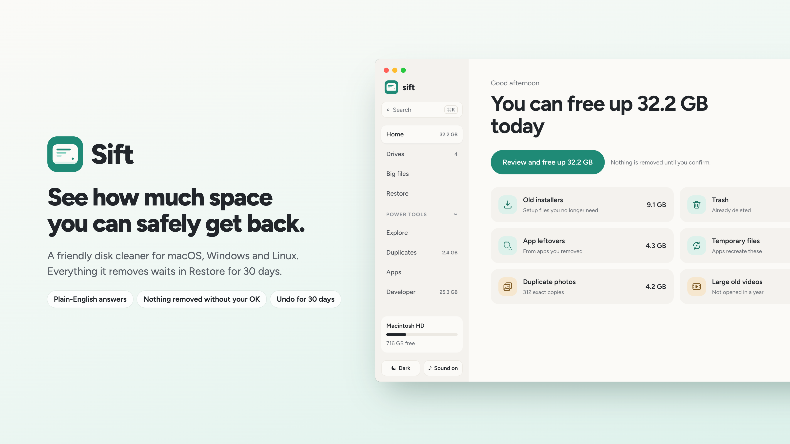
</p>

# Sift

[](https://github.com/idevtim/sift/releases/latest)

[](LICENSE)

A free, open-source disk-space cleaner for macOS, Windows and Linux. Sift answers one question, *how much can I safely free up?*, explains what it finds in plain words, and lets you act in one click.

Nothing is deleted on the spot. Whatever Sift removes waits in **Restore** for 30 days, so you can always change your mind.

**[Download the latest release](https://github.com/idevtim/sift/releases/latest)** · [All releases](https://github.com/idevtim/sift/releases) · [What's new](release-notes/)

## Screenshots

<p align="center">
  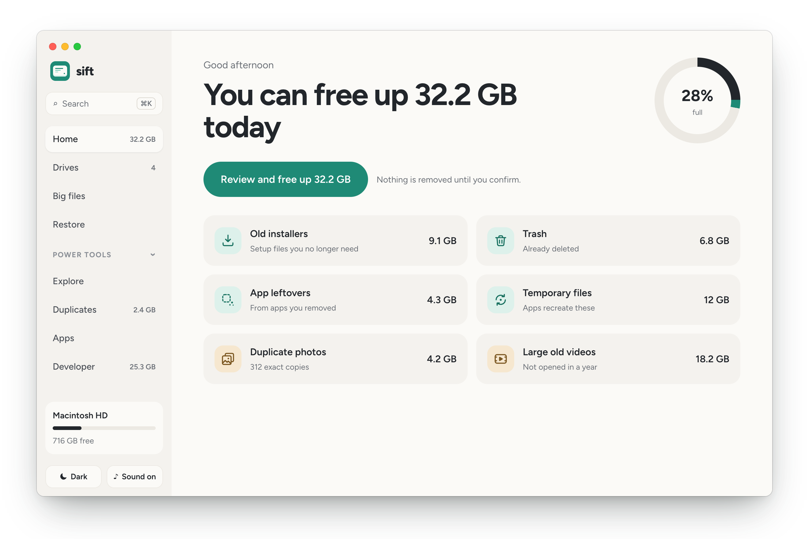
  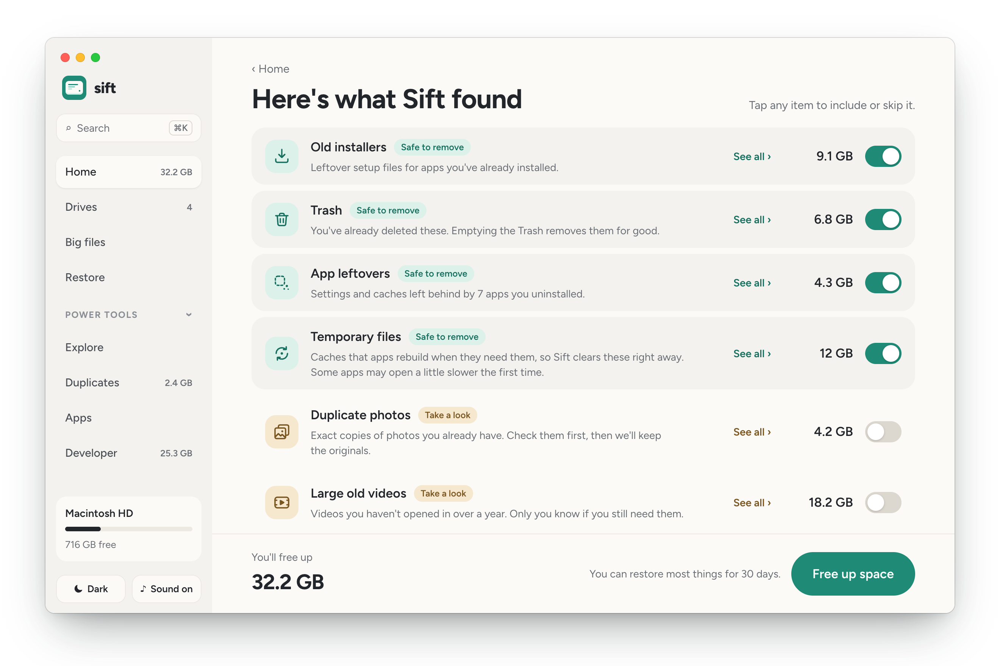
</p>

<p align="center">
  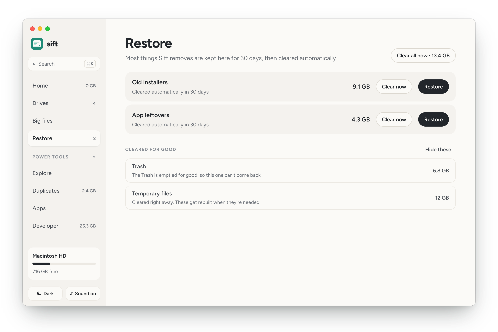
  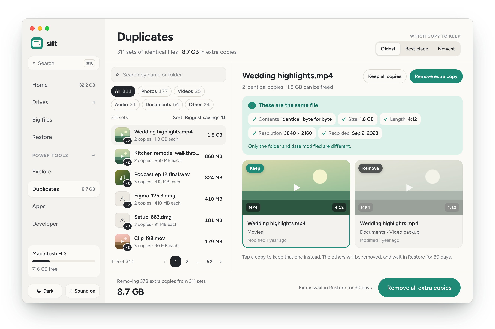
</p>

<details>
<summary><b>More screenshots</b></summary>
<br>

<p align="center">
  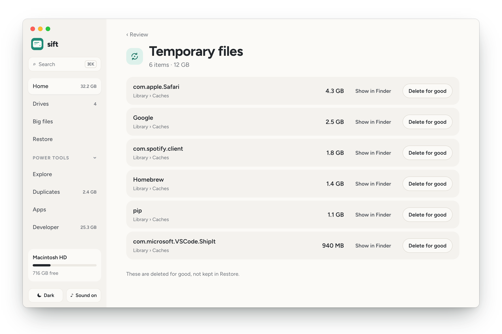
  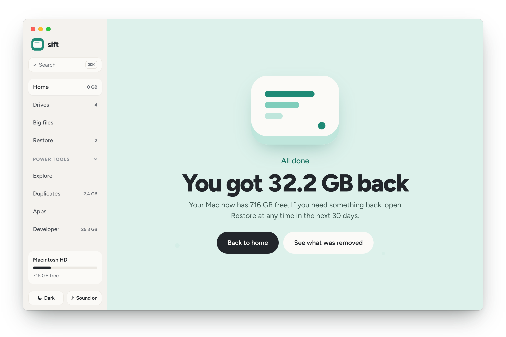
</p>

<p align="center">
  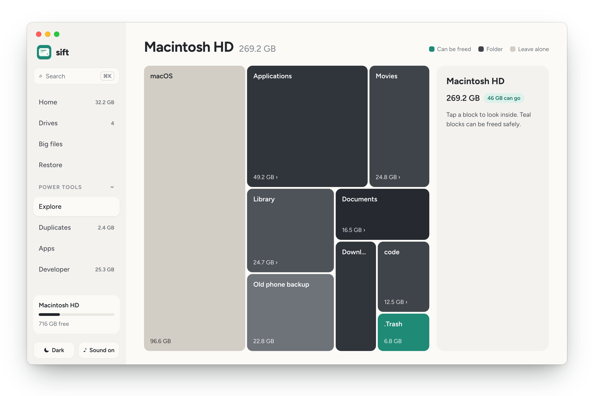
  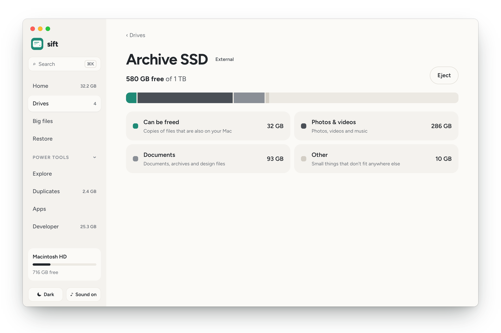
</p>

<p align="center">
  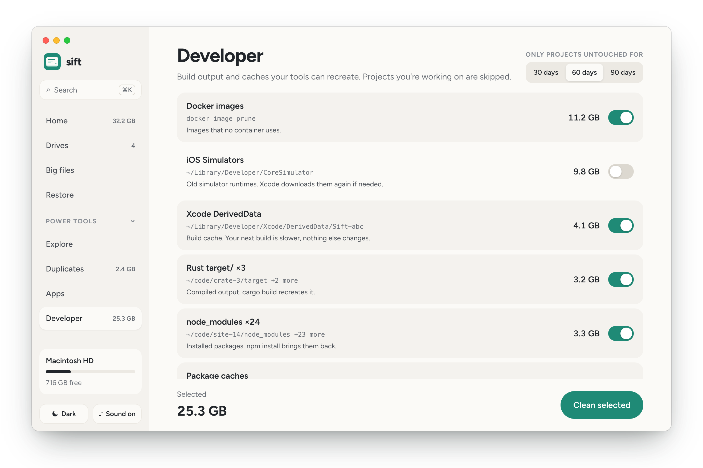
  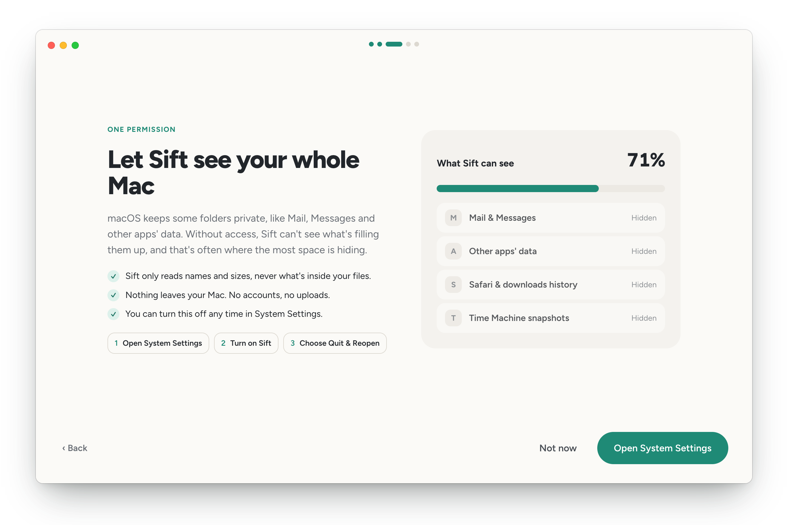
</p>

<p align="center">
  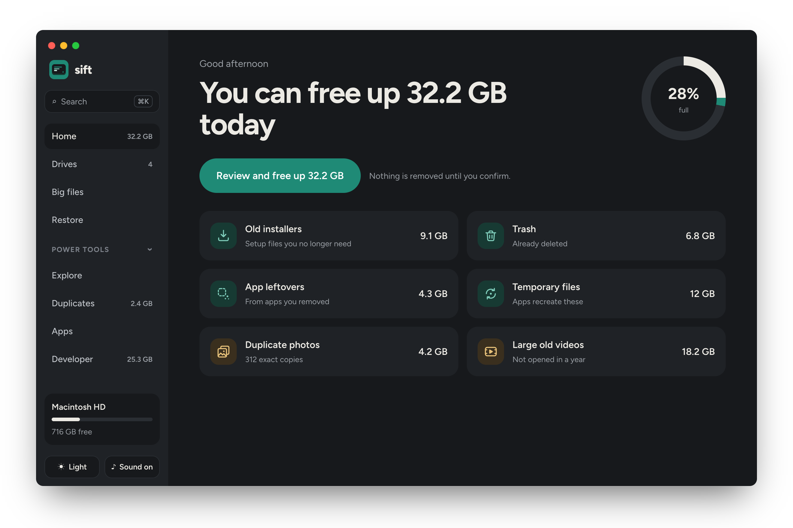
</p>

</details>

## Features

- **One clear number**: Home tells you how much you can free up today
- **Six everyday categories**: old installers, the Trash (Recycle Bin on Windows), leftovers from apps you've uninstalled, temporary files, duplicate photos, and large videos you haven't opened in a year
- **Review before anything happens**: safe categories start switched on, anything worth a second look starts off, and **See all** lists every file behind a category
- **Restore for 30 days**: put anything back with one click, or **Clear now** to free the space early
- **Drives**: every connected disk at a glance, including what's on external drives and SD cards. Backup drives are never touched
- **Big files**: the largest things you haven't opened in a while
- **Power tools** for a closer look:
  - **Explore**: a treemap of your disk you can click into
  - **Duplicates**: exact copies side by side; keep the oldest, newest, or best-placed copy, or pick one yourself
  - **Apps**: uninstall an app along with the settings and caches it leaves behind
  - **Developer**: Docker images, iOS simulators, Xcode DerivedData, Rust `target/` and `node_modules` from projects you haven't touched lately
- **Weekly check-up**: one notification on Sundays if there's space worth freeing. It never removes anything on its own
- **Quick search** with ⌘K / Ctrl+K across files, pages and actions
- **Light and dark appearance**, optional sounds, and a short guided setup
- **Auto-update**: new versions download in the background; restart from the sidebar to install

## Install

### Download (recommended)

Get the file for your computer from the [latest release](https://github.com/idevtim/sift/releases/latest):

| Platform | File | Notes |
|----------|------|-------|
| **macOS** 10.15+ | `Sift_<version>_universal.dmg` | Apple Silicon and Intel. Signed and notarized by Apple |
| **Windows** 10+ | `Sift_<version>_x64-setup.exe`<br>`Sift_<version>_arm64-setup.exe` | Installs for your user only, no admin needed |
| **Linux** (x86_64) | `.AppImage`, `.deb` or `.rpm` | Ubuntu 22.04+, Fedora, or similar |

**On macOS**, open the DMG and drag Sift to Applications. On first launch Sift explains why it needs **Full Disk Access** (macOS keeps Mail, Messages and other apps' data private) and opens the right page in System Settings. Turn Sift on, choose **Quit & Reopen**, and you're set. You can skip it; Sift works with what it's allowed to see, and Home offers it again later.

### Homebrew (macOS)

```sh
brew install --cask idevtim/tap/sift
```

Same signed build, from the tap. Sift updates itself afterwards, so `brew upgrade` leaves it alone unless you pass `--greedy`. `brew uninstall --zap --cask sift` also removes Sift's settings and the weekly check-up, and clears anything still waiting in Restore.

### Build from source

**Requirements:** Node 20+, Rust 1.90+, and the [Tauri 2 prerequisites](https://v2.tauri.app/start/prerequisites/) for your OS.

```bash
git clone https://github.com/idevtim/sift.git
cd sift
npm install
npm run tauri:dev    # run the full app (the first Rust compile takes a few minutes)
npm run tauri:build  # unsigned installers land in src-tauri/target/release/bundle/
```

> **Tip:** `npm run dev` runs just the interface in your browser at http://localhost:1430, with sample data. No Rust needed.

## How it works

1. **Look.** Sift reads names and sizes on your disk, never what's inside your files. The quick checks land in seconds; duplicates and old videos follow once the full scan finishes.
2. **Review.** Each category is explained in plain words, so you know what you're removing.
3. **Free up.** Your selection moves into a holding area on the same drive, which is instant.
4. **Restore.** Anything you removed stays there for 30 days, then it's cleared for good.

**What keeps it safe**

- **Removing means moving.** Nothing is deleted in place.
- **A few things are deleted right away**, and Sift says so first: emptying the Trash, and caches or build output that apps rebuild on their own (holding those would only keep the space taken).
- **Backup and external drives are read-only.** Sift shows what's on them but never cleans them. System files are never touched.
- **Cloud files stay in the cloud.** iCloud files that aren't downloaded are never opened, so a scan never triggers downloads.
- **Easy on your computer.** Scans use about a quarter of your processor cores, at low priority.
- **Fully local.** No account, no telemetry. The only network request is the update check against GitHub Releases. See [PRIVACY.md](PRIVACY.md) for details.

## Feedback

- **Something not working?** [Report a bug](https://github.com/idevtim/sift/issues/new?template=bug_report.md)
- **Download or install trouble?** [Report a download issue](https://github.com/idevtim/sift/issues/new?template=download_issue.md)
- **Idea for Sift?** [Suggest a feature](https://github.com/idevtim/sift/issues/new?template=feature_request.md)
- **Security issue?** Please don't open a public issue; see [SECURITY.md](SECURITY.md)

## Contributing

Contributions are welcome! Fork the repo, make your changes, and open a PR.

```bash
# Fork and clone
git clone https://github.com/YOUR_USERNAME/sift.git
cd sift
npm install

# Run it
npm run tauri:dev

# Check your work
npm run typecheck
cd src-tauri && cargo test && cargo clippy
```

[CONTRIBUTING.md](CONTRIBUTING.md) covers the safety rules every change has to follow, and [CLAUDE.md](CLAUDE.md) has detailed architecture notes.

## Project structure

```
src/                React UI (TypeScript, Tailwind)
  views/            one folder per screen
  components/       shared UI, onboarding, ⌘K palette, toasts
  lib/              typed bridge to Rust, plain-words copy, browser sample data
  stores/           UI state (Zustand)
src-tauri/          Rust core (Tauri 2)
  src/scanners/     read-only scanners: disk index, categories, apps, drives, duplicates
  src/restore.rs    the 30-day holding area
  src/checkup.rs    weekly check-up scheduler
release-notes/      notes for each version
scripts/            build and release tooling
```

Built with Tauri 2 · Rust · React 19 · TypeScript · Vite · Tailwind 4 · TanStack Query · Zustand.

## License

MIT, see [LICENSE](LICENSE) for details. © 2026 Timothy Murphy
